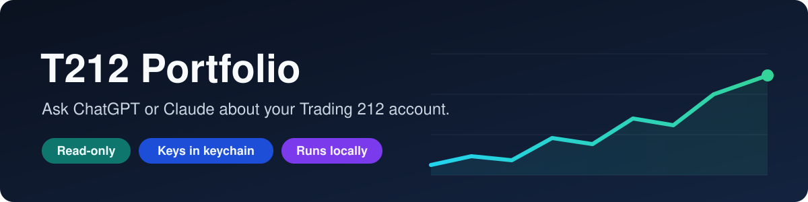
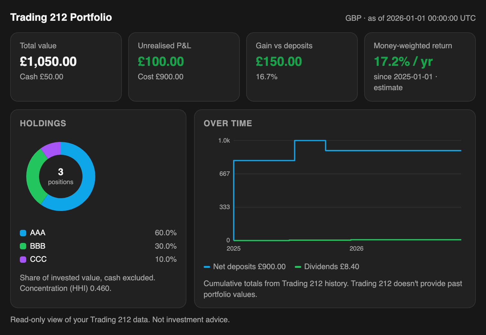

<p align="center">
  
</p>

<p align="center"><b>English</b> · <a href="README.zh-CN.md">简体中文</a></p>

Ask ChatGPT or Claude about your Trading 212 portfolio and get answers, and charts, from your real account.

It runs on your computer and can only read your account. Your API key is stored in your system keychain and is never shown to the AI.

<p align="center">
  
</p>

## What it can do

- **Dashboard in the chat:** key figures, a holdings chart and your history over time.
- **Holdings and allocation:** value, cost, profit and concentration.
- **Performance:** gain against what you've put in, and an estimated yearly return.
- **History:** deposits, withdrawals, dividends and past trades.
- **English and Chinese.**

## Install

ChatGPT desktop app:

```sh
curl -fsSL https://raw.githubusercontent.com/Aska0526/Trading-212-Portfolio-Skill/main/install.sh | sh -s -- chatgpt
```

Claude Code:

```sh
curl -fsSL https://raw.githubusercontent.com/Aska0526/Trading-212-Portfolio-Skill/main/install.sh | sh -s -- claude-code
```

The installer asks for your Trading 212 API key and secret in the terminal, then sets everything up.

To create a key in Trading 212, go to **Settings → API (Beta) → Generate API key**. Enable read permissions only, not orders.

**ChatGPT users:** restart the app, open **Plugins → Personal** and install **t212-portfolio**. Then use it in a **Work** or **Codex** thread. Regular Chat threads run on OpenAI's servers and can't reach your computer.

## Try asking

- "Show my portfolio dashboard."
- "How am I doing against what I've deposited?"
- "What's my allocation and how concentrated am I?"
- "What did I buy and sell this year?"

## Uninstall

```sh
t212 uninstall --client chatgpt   # or claude-code
t212 logout                       # delete the saved key
```

## Notes

- Read-only. It can't place orders or move money.
- Nothing is stored on your computer except the app and your key.
- Trading 212 doesn't provide past portfolio values, so charts show deposits, dividends and realised profit over time.
- Works with Invest and Stocks ISA accounts.
- Not affiliated with Trading 212. Not investment advice.

MIT License
