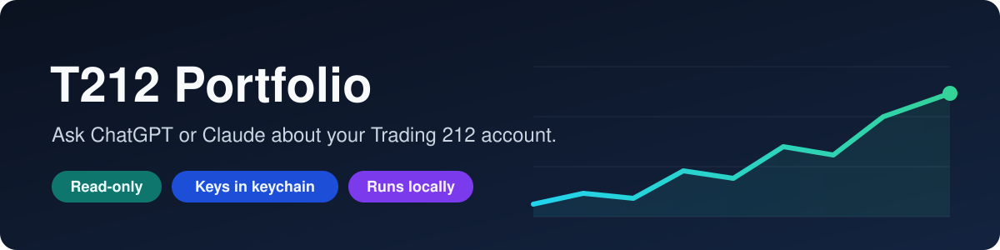
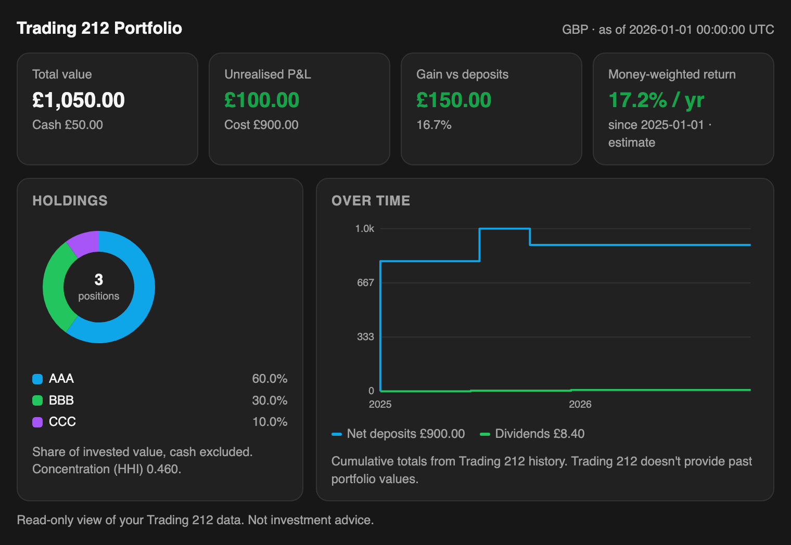

<p align="center">
  
</p>

<p align="center"><a href="README.md">English</a> · <b>简体中文</b></p>

用 ChatGPT 或 Claude 查询你的 Trading 212 投资组合，直接根据真实账户数据给出回答和图表。

它在你的电脑上运行，只能读取账户数据。API 密钥保存在系统钥匙串中，不会显示给 AI。

<p align="center">
  
</p>

## 功能

- **对话内仪表盘：** 关键数据、持仓图和历史走势。
- **持仓与配置：** 市值、成本、盈亏和集中度。
- **收益表现：** 相对存入资金的收益，以及估算年化收益率。
- **历史记录：** 存入、取出、分红和过往交易。
- **支持中文和英文。**

## 安装

ChatGPT 桌面应用：

```sh
curl -fsSL https://raw.githubusercontent.com/Aska0526/Trading-212-Portfolio-Skill/main/install.sh | sh -s -- chatgpt zh
```

Claude Code：

```sh
curl -fsSL https://raw.githubusercontent.com/Aska0526/Trading-212-Portfolio-Skill/main/install.sh | sh -s -- claude-code zh
```

安装程序会在终端中请你输入 Trading 212 的 API 密钥和 Secret，然后自动完成设置。

创建密钥：在 Trading 212 中打开 **设置 → API (Beta) → 生成 API 密钥**。只开启读取权限，不要开启下单权限。

**ChatGPT 用户：** 重启应用，打开 **插件 → 个人**，安装 **t212-portfolio**，然后在 **Work** 或 **Codex** 对话中使用。普通 Chat 对话运行在 OpenAI 的服务器上，无法访问你的电脑。

## 可以这样问

- “显示我的投资组合仪表盘。”
- “相对于我存入的资金，我的收益如何？”
- “我的资产配置是怎样的？集中度高吗？”
- “我今年买卖了哪些股票？”

## 卸载

```sh
t212 uninstall --client chatgpt   # 或 claude-code
t212 logout                       # 删除保存的密钥
```

## 说明

- 只读，无法下单或转移资金。
- 除程序本身和密钥外，不会在电脑上保存任何数据。
- Trading 212 不提供历史账户价值，因此图表显示的是存入、分红和已实现盈亏的累计走势。
- 支持 Invest 和 Stocks ISA 账户。
- 与 Trading 212 无关联，不构成投资建议。

MIT 许可证
